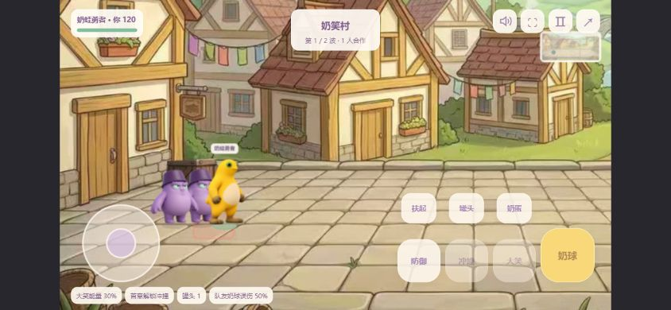

# 营救豆包

基于《勇者奶蛙传：关于如何从憋笑魔王手中救下公主这件事》公开网页构建产物改编的 1–4 人合作试玩版。当前版本 **0.5.0**，本协作快照整理于 **2026-11-01（Asia/Shanghai）**。

- [在线试玩](https://rescue-doubao.netlify.app/)
- [GitHub 协作仓库](https://github.com/acane117/rescue-doubao)（当前为私有仓库）
- [原游戏网页](https://h5.metaapp.cn/online/h5/BUsvkkbBiAq2pF2Ttx4j/1.0.2/6/index.html)
- [完整来源与改动说明](SOURCES.md) · [许可状态](LICENSE.md) · [协作指南](CONTRIBUTING.md)

**本项目不是原作者官方版本，也不是原作者未发布的原始工程。** 原游戏战斗模块和声音模块来自公开压缩构建文件，角色、场景和原音轨复用了原网页资源。原作者姓名及原游戏再分发许可尚未核实；本包没有将整个项目声明为 MIT 或其他统一开源许可。新增实现由需求提出者与 Codex 协作完成，角色高清图由内置 imagegen 参照原角色生成。详见来源文件。



## 快速启动

使用 Node.js 22 或 24。项目不需要安装 npm 依赖，也没有构建步骤。

```sh
npm start
```

浏览器打开 http://localhost:4173 。不要直接双击 HTML，ES 模块需要通过 HTTP 服务加载。

```sh
npm test          # 45 项游戏逻辑、音频、网络、渲染和横屏测试
npm run check    # 语法、静态资源检查及全部测试
```

联机使用 PeerJS 公共信令服务及 WebRTC。远程朋友使用 HTTPS 地址；严格 NAT 或限制 WebRTC 的网络可能无法直连，本版未配置 TURN 中继。

## 当前成果

- 房间码和邀请链接、1–4 人合作、独立操作与生命值、倒地救援及免费重试。
- 七章关卡与原怪物、Boss 行为；小怪总量按人数增加，Boss 血量为原血量 × 70% × 本关人数，伤害为原伤害 × 75%。
- 队友奶球造成正常伤害的 50%，会阻挡子弹；地图宽高各扩大 50%。
- 原版 8 个 MP3、原射击/防御/受击/Boss 招式合成音效、静音与暂停控制。
- 八帧迈腿、无外圈光晕的新角色图、镜头活动范围、每帧完整重绘。
- 手机 16:9 横屏战斗、旋转后的摇杆方向映射、放大的触控技能按钮。

## 代码位置

本项目为无构建步骤的 ES 模块网页，`dist/` 同时是可编辑源码和部署目录，不是需要重新生成的编译产物。

| 路径 | 用途 |
| --- | --- |
| `dist/base.js` | 从原公开游戏构建提取并适配的战斗内核，压缩格式保留 |
| `dist/coop.js` | 合作战斗、人数倍率、友伤、救援和快照 |
| `dist/network.js` | 房间、PeerJS 数据通道与输入协议 |
| `dist/app.js` | 大厅、输入、HUD、升级和战斗流程 |
| `dist/render.js`、`dist/view.js` | Canvas 绘制、步态与镜头 |
| `dist/mobile.js`、`dist/style.css` | 横屏、旋转输入与响应式界面 |
| `dist/audio-original.js`、`dist/audio.js` | 原声音控制器与合作适配 |
| `dist/assets/`、`art/` | 原美术/音轨、AI 衍生图及生成提示 |
| `tests/` | 45 项自动测试 |
| `upstream/` | 原网页公开构建文件，仅作溯源参照，不是可单独运行的原工程 |
| `SOURCES.md`、`PROVENANCE.json` | 来源说明与逐文件来源记录 |

## 操作

WASD / 方向键移动；F 连发奶球；空格防御；Shift 冲撞；E 大笑；C 罐头；V 奶蛋；H 扶起队友；J 跳跃；Escape 暂停。最终战 Q 讲笑话，蓄满后再按 Q，连按 R 维持大笑。手机使用摇杆和按钮。

## 参与协作

仓库位于 https://github.com/acane117/rescue-doubao ，当前为私有仓库。维护者先在仓库 Settings → Collaborators 邀请协作者，获得权限后克隆项目。源码按正常目录结构提交，不需要从仓库内再解压 ZIP；不要将 `dist/` 加入忽略列表。

```sh
git clone https://github.com/acane117/rescue-doubao.git
cd rescue-doubao
npm start
```

GitHub Actions 已配置语法、资源和测试检查，向 `main` 推送或提交 Pull Request 时触发；具体运行结果以仓库 Actions 页面为准。

协作请使用功能分支和 Pull Request，规则见 [CONTRIBUTING.md](CONTRIBUTING.md)。原游戏授权未确认，创建仓库时不要为整个项目直接套用 MIT 等模板许可；先由维护者核实相关权利。

## 部署

`netlify.toml` 的发布目录为 `dist`，无须构建。可在自己的 Netlify 账号绑定仓库，或将 `dist` 内容打包后手动上传。不要复用他人的站点 ID。新建站点可能默认私有，生产部署完成后设置为 Public，并用未登录浏览器验证。

当前线上地址仅作成果演示；本包不含生产账号绑定、部署令牌或自动发布密钥。换用新域名时同步修改 `dist/index.html` 的 `og:url`。

## 验证与边界

本包已在独立解压目录运行 `npm run check`，45 项测试通过。历史浏览器检查包括同机两个客户端的 PeerJS 建房、加入、开战和失败同步，以及 390×844、844×390 视口的横屏布局。未完成跨运营商真实手机联机验证，不将本地计算耗时或模拟视口结果表述为真实设备帧率。

房主离开即结束本局，尚不支持房主迁移、战斗中加入和断线恢复。原结局视频与部分复杂视觉特效未迁移。后续优化方向见 [docs/ROADMAP.md](docs/ROADMAP.md)，历次改动见 [docs/DEVELOPMENT_HISTORY.md](docs/DEVELOPMENT_HISTORY.md)。

`SNAPSHOT.json` 记录交付时各文件 SHA-256；`npm run verify:snapshot` 适合核对原始交付包，修改源码后应在正式发布时重新生成快照。
